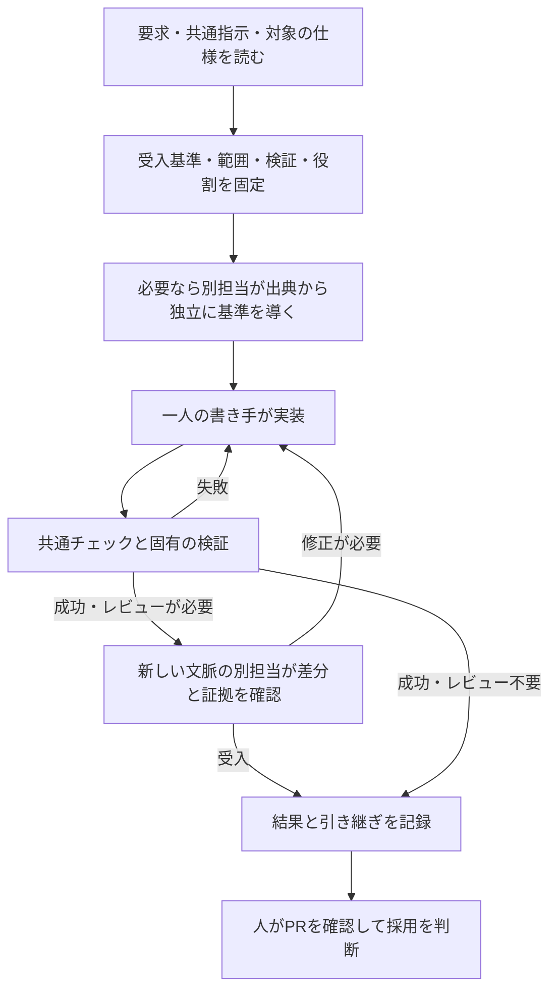
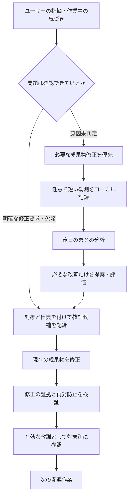
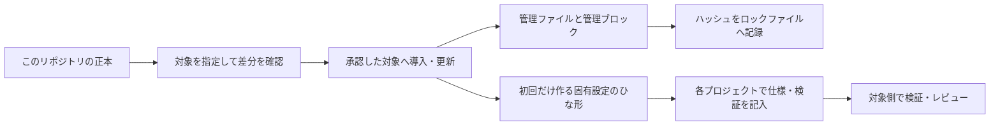

# AI開発ハーネス

Claude CodeとCodexで、**要求の確認から実装・検証・レビュー・再発防止までを同じ手順で進める**ための運用テンプレートです。AIの回答だけを信用せず、「何を満たすか」「何を確かめたか」を残します。モデルを再学習する仕組みではありません。効果は実際の作業で測り、手順を見直します。

## 何に効くのか

| 開発で起きること | ハーネスの働き | 確認できるもの |
|---|---|---|
| 意図と違うものを実装する | 要求から受入基準を先に固定する | 要求と基準の対応、未決事項 |
| 「直した」で作業が終わる | 共通チェックとプロジェクト固有の検証を実行する | 成功・失敗・未検証の区別 |
| 同じAIが見落とし続ける | 必要な作業は新しい文脈の別担当がレビューする | 要求から独立に導いた基準と差分の照合 |
| 同じ指摘が繰り返される | 対象別に記録し、証拠と再発防止を確認して教訓にする | 有効な教訓と未判定の観測の分離 |
| 指示が増えて読まれなくなる | 必要な文書だけ読み、効果のないルールを統合・廃止する | 比較評価と見直しの判断 |
| 複数AI・端末の作業が衝突する | 書き手を一人にし、停止と引き継ぎを明示する | 担当、コミット、次の作業 |

## 作業中はどう効くのか



これはエージェントが従う作業手順です。全体を自動実行するサービスではありません。修正・検証は原則3回まで。同じ失敗が2回続けば原因や設計を見直します。必要な検証やレビューができなければ、完了扱いにしません。

## 指摘はどう次の作業に活きるのか



`feedback.py` は確認された指摘と再利用する教訓を扱います。`observe.py` は原因未判定の観測を扱い、普段の文脈へ自動で読み込ませません。観測を記録しただけでは教訓に昇格しません。詳細調査の子エージェントや節目レビューも任意導入です。

## 文書と仕組みの配置

| 場所 | 役割 |
|---|---|
| `AGENTS.md` / `CLAUDE.md` | エージェントの入口、常時適用する安全ルール |
| `.ai/README.md` / `.ai/project.md` | 共通手順の案内とプロジェクト固有の前提 |
| `.ai/workflows/` | 変更、レビュー、役割分担、改善の手順 |
| `.ai/standards/` / `.ai/verification/` | 安全基準と検証の完了条件 |
| `.ai/knowledge/` | 構成案内、意思決定、作業一覧 |
| `.ai/feedback/` | 対象別の教訓と観測記録の使い方 |
| `.agent-state/` | Gitに入れない作業・観測・利用枠の記録 |
| `scripts/agent/` | 検証、役割予約、引き継ぎ、記録のコマンド |
| `scripts/project/` | 各プロジェクトが用意する検証 |
| `scripts/harness/` | この正本から他リポジトリへ配布する仕組み |

仕様と判断理由は文書、繰り返す手順はワークフローやスキル、機械判定できる条件はテストやCI、危険な操作は権限やフックに置きます。禁止事項を文章に書くだけで操作を強制的に防げるわけではありません。

## このリポジトリを試す

必要環境はmacOSまたはLinux、Bash 3.2以上、Python 3.9以上、Gitです。GitHub操作には認証済みのGitHub CLIなどが別途必要です。

```bash
# 文書・構成・安全ルールの整合性を確認
scripts/agent/verify-change.sh agent-env

# 共通テストと、このテンプレート固有の検証を実行
scripts/agent/verify-change.sh full
```

成功したCIは、画面品質やAIレビューの実施まで証明しません。検証結果の読み方は[共通の検証条件](.ai/verification/common.md)を参照してください。

## 自分のプロジェクトへ導入する

このリポジトリが配布元の正本です。設定上の既定範囲は `~/work`、除外は `notes` ですが、ファイルが存在するだけで全プロジェクトへ導入されるわけではありません。



まず対象を一つ指定し、書き込みのない変更計画を確認します。`<repo>` は実際のプロジェクト名に置き換えてください。

```bash
python3 scripts/harness/sync.py install ~/work/<repo> --dry-run
# 対象と差分を確認し、導入が承認されたら実行
python3 scripts/harness/sync.py install ~/work/<repo>
# 正本更新後も、差分を確認してから反映
python3 scripts/harness/sync.py sync ~/work/<repo> --dry-run
python3 scripts/harness/sync.py sync ~/work/<repo>
# 指定した対象だけを読み取り確認
python3 scripts/harness/sync.py status ~/work/<repo>
python3 scripts/harness/sync.py health ~/work/<repo>
```

- `managed` は更新対象です。導入先で直接変更されていれば同期を拒否します。
- `seeded` は存在しない場合だけ作り、以後はプロジェクト側で管理します。
- 入口文書は `HARNESS:START` と `HARNESS:END` の管理ブロックだけを更新します。
- 同期はコミットやプッシュを行いません。無関係な変更のある作業場所への反映を避け、対象ごとに検証します。

導入後は `.ai/project.md`、構成案内、安全基準の固有設定、検証条件を埋め、`scripts/project/verify.sh` に実際の検査を用意してください。詳細は[共通環境の入口](.ai/README.md)を参照してください。

`guard.py` は対応するフックとして別途設定された場合に働きます。対象範囲での未導入状態や管理ファイルの直接編集を検知し、古いブランチには警告します。内部エラー時は操作を止めない設計で、`AGENT_HARNESS_GUARD=off` で停止できます。このPRや同期コマンドだけで端末全体のフックは設定されません。

## 普段の使い方と役割分担

作業開始時に要求・受入基準・範囲・検証・停止条件を引き継ぎへ記録し、役割を予約します。

```bash
scripts/agent/create-handoff.sh
scripts/agent/reserve-routing.py \
  --task-id example_docs --policy-version v3 \
  --area-id docs --task-type docs --risk low --intended-pattern P0
```

予約結果の `review_required` に従い、必要なレビューを実施してから `record-completion.py` で実際の結果を記録します。詳細は[変更手順](.ai/workflows/change.md)と[引き継ぎひな形](.ai/handoffs/template.md)を参照してください。

役割構成は、単独で進めるP0、書き手と独立レビュアーのP1、計画担当も分けるP2、読み取り調査を分けるP3です。既定のv3はClaudeが計画・実装、Codexがテスト・修正を担当し、相互に別担当の成果をレビューします。書き手の交代前には停止と引き継ぎが必要です。相手が利用できない場合の代替も記録し、レビューを省略しません。v1/v2は過去の記録との互換用に残しています。

利用枠は端末数で増えません。残量は実測で記録し、一つの調整役で管理します。候補の推薦は利用枠の予約や自動起動ではありません。[役割分担](.ai/workflows/routing.md)と[利用枠・端末間引き継ぎ](.ai/workflows/subscription-scheduling.md)に詳しく記載しています。

## 改善するときに読む文書

| 目的 | 文書 | 適用範囲 |
|---|---|---|
| 確認された指摘を記録・検証する | [教訓の記録](.ai/feedback/README.md) | 通常の改善手順 |
| 原因不明の気づきを短く記録する | [観測の記録](.ai/feedback/observations.md) | コマンドは配布対象、実行は任意 |
| 開発と原因分析を分離する | [後日の分析](.ai/workflows/deferred-feedback.md) | 正本内の任意ガイド、配布対象外 |
| 要件・設計の対話や合意を確認する | [節目レビュー](.ai/workflows/upstream-review.md) | 正本内の任意ガイド、配布対象外 |
| 指示を評価・統合・廃止する | [保守と効果測定](.ai/workflows/harness-maintenance.md) | 正本内の任意ガイド、配布対象外 |
| GitHub CIとAIレビューを設定する | [GitHubレビュー](.ai/workflows/github-review.md) | 外部サービス側の設定が別途必要 |

## 境界と補助機能

自動マージ、無人の配布、利用枠の追加購入、モデルの再学習は行いません。秘密情報や会話全文を教訓・引き継ぎ・Gitへ保存しません。全チャットの常時監視やルールの自動書き換えもありません。

個人環境用のセッションノート機能はハーネスの必須部分から分離しています。[補助機能の説明](docs/session-notes.md)を参照してください。既定では停止状態で、会話の転送や外部リポジトリへの同期を有効にするには別途許可が必要です。
